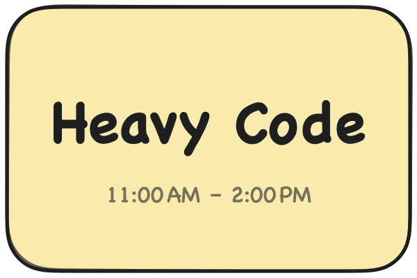
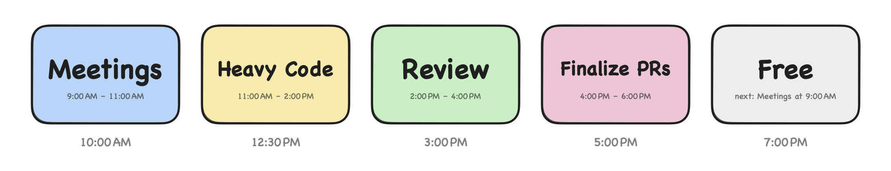
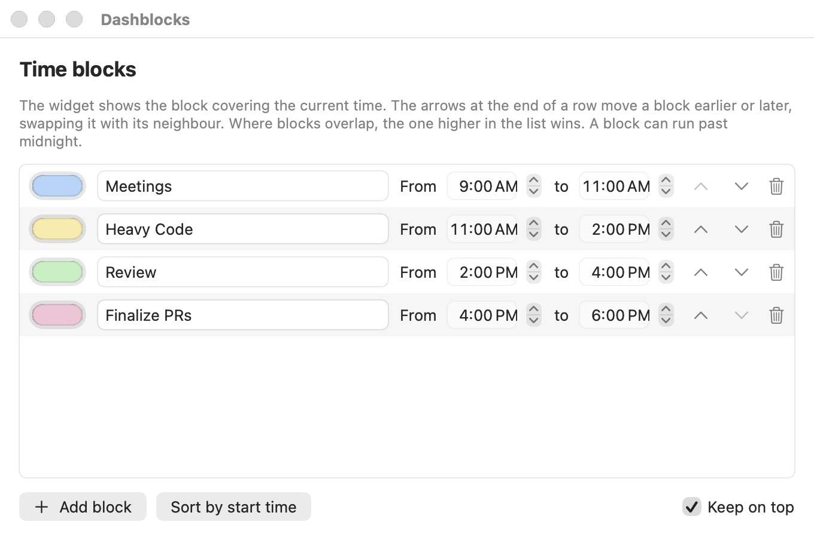

# Dashblocks

A small block that floats on your Mac's screen and shows what you planned for
this part of the day. Split your day into colour-coded time blocks — say
Meetings in the morning, Heavy Code around midday, Review in the afternoon — and
Dashblocks shows the block you are in now, with its name and the times it runs.



## Through the day

The widget changes as the day moves through your blocks. Between blocks it shows
**Free** and what comes next.



## Using it

- **Move it:** drag it from anywhere.
- **Resize it:** drag any edge or corner. The name scales to fit.
- **Edit your blocks:** double-click the widget, or right-click it and choose
  **Edit Blocks…**.
- **Keep on Top:** right-click to switch it on or off. On, it floats over other
  windows; off, it sits among them. Either way it appears on every Space.
- **Quit:** right-click → **Quit Dashblocks**.

It remembers where you put it, its size, and your blocks.

## Editing blocks



Each block has a colour, a name, and the times it runs from and to.

- **Add block** adds an hour-long block after your last one.
- The trash button deletes a block.
- The up arrow moves a block earlier in the day and the down arrow later: it
  swaps places with its neighbour, and both keep their lengths. **Sort by start
  time** puts the list in time order.
- A block can run past midnight: set it from 10:00 PM to 1:00 AM, say.
- Where blocks overlap, the one higher in the list wins.

Dashblocks starts with four example blocks (Meetings 9–11 AM, Heavy Code
11 AM–2 PM, Review 2–4 PM, Finalize PRs 4–6 PM) and opens the settings on first
launch so you can set your own.

## Install

Needs macOS and the Xcode command line tools (`swiftc`).

```sh
git clone https://github.com/CheyenneAtapour/dashblocks.git
cd dashblocks
./install.sh            # build into ~/Applications/Dashblocks.app and open it
./install.sh --login    # the same, and open it at login too
```

Run it again after changing the source; your blocks and the widget's place are
kept (they live in the app's preferences, `com.cheyenneatapour.dashblocks`).

To stop opening it at login:

```sh
launchctl bootout gui/$(id -u)/com.$USER.dashblocks
rm ~/Library/LaunchAgents/com.$USER.dashblocks.plist
```

## Screenshots

The images in `docs/` are drawn offscreen from the app's own views, with the
example blocks. To redraw them after changing the UI:

```sh
swiftc -O Dashblocks.swift -o /tmp/Dashblocks && /tmp/Dashblocks --screenshots docs
```
